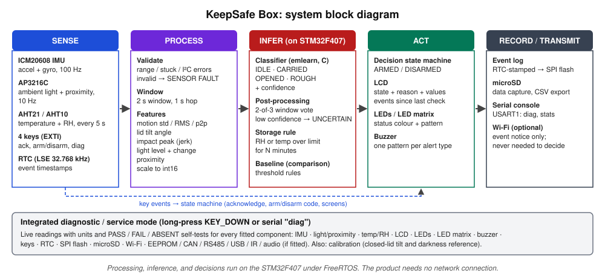

# M1: Product Concept and Requirements

**Product:** *KeepSafe Box*, a smart storage box that knows when it has been **opened, carried, or handled roughly**, and warns when the air inside gets **too humid or hot** for what it holds. Everything is decided on the box itself, with no Internet connection.

**Status:** concept frozen for M1. The component matrix is preliminary until the M3 hardware inventory. All targets below are *design targets*, not results.

---

## 1. Problem statement

The target users are people who keep important or sensitive things in a box at home: a student in a shared boarding house or dorm, or a household keeping medicines, IDs, land titles, photos, or small electronics. These users have two everyday problems. First, they cannot tell whether someone **opened or moved** the box while they were away, or whether it was **knocked or dropped** while being moved. Second, in a humid tropical climate like Iligan's, stored items such as medicines, paper documents, photos, and electronics degrade quietly when the air inside a closed box stays **damp or warm** for long periods. The box sits indoors on a shelf, desk, or under a bed most of the time. It is carried occasionally, opened a few times a day, and often left alone for hours, in rooms whose lighting ranges from daylight to completely dark. The product goal is to give the owner a **trustworthy local record and immediate feedback** of what happened to the box and to its storage conditions, using no camera, no cloud service, and no smartphone. The owner sees the summary ("since your last check: opened 1×, carried 0×, rough 0×, humidity high 2 h") the next time they open the lid.

## 2. Alternatives considered

| Concept | Classes | Why not chosen |
|---|---|---|
| **A. KeepSafe Box (chosen)** | IDLE, CARRIED, OPENED, ROUGH, plus a storage-condition rule | — |
| B. Laundry/appliance vibration monitor | IDLE, WASH, SPIN, UNBALANCED | Each class depends on real machine cycles (about an hour each), so collecting about 60 independent instances per class in the lab timeline is not feasible. The board would also sit near water. |
| C. Context-aware study desk | AWAY, PRESENT-IDLE, WORKING, BUMP | Desk vibration from typing or writing gives a weak IMU signal and classes blur together. Presence is mostly a single proximity threshold, so ML would add little over rules. |

**Why A:** it is the only option where (1) **two sensing modalities** (motion/orientation from the IMU and light/proximity from the AP3216C) carry complementary evidence for the *same* decision, (2) every class can be **acted out safely and quickly about 60 times** (30 train + 10 test windows plus 20 system trials), and (3) a simple threshold has known failure cases that a trained model can be shown to fix (Section 4.3). The temperature/humidity sensor adds a second, independent consumer benefit that uses the remaining onboard sensor meaningfully.

## 3. Physical design

| Decision | Choice | Reason |
|---|---|---|
| Enclosure | Hinged-lid plastic storage box, about 30 × 20 × 12 cm (prototype) | Repeatable lid motion, and the board fits inside |
| Board position | **Fixed to the inside of the lid, components facing down** into the box (standoffs + foam) | Opening the lid **rotates the board** (IMU gravity vector shifts by about 90°) **and lets light in** (AP3216C), giving two independent cues. The AHT sensor measures the **air inside the box**, which is the air that matters for stored items. The LCD faces the user whenever the lid is open. |
| Power | USB power bank on the box floor during product use; USB serial cable only during development and data capture | Cable tension must not distort motion data (see PLAN risk register) |
| Feedback when closed | Buzzer (audible through the lid) | The LCD is only visible with the lid open, so alerts while closed are audible and the full detail is shown on the next open |

## 4. Classification states

### 4.1 Operational definitions

All four classes are predicted by the on-device classifier from one window of sensor data (2 s, hop 1 s).

| Class | Definition | Lid | Typical signals | How to reproduce one trial |
|---|---|---|---|---|
| **IDLE** | Box closed and resting on a surface, not handled. **Includes** normal background disturbance: someone typing at the same desk, a door closing in the room, walking past. | Closed | Gravity steady, low motion energy, dark | Place the box on a desk, shelf, or bed and record ≥ 10 s. Vary the surface and background activity. |
| **CARRIED** | Box closed, lifted and moved by a person: held in two hands, under one arm, or in a bag. Includes picking it up and putting it down **gently**. | Closed | Periodic motion from walking (about 1.5–2 Hz), moderate tilt changes, dark | Pick up, walk 5–10 m, put down. Vary the carrying style and walking speed. |
| **OPENED** | Lid opened while the box stays on a surface. A person looks inside, takes out or puts back an item, then closes it. | Open | Lid tilt about 90–110°, light rises (unless the room is dark), small hand-induced motion, proximity changes | Open the lid, take out or return an item, close. Repeat in **bright, dim, and dark** rooms. |
| **ROUGH** | Handling that could damage contents: vigorous shaking, knocking or banging on the box, tipping it over, or a short drop onto a soft surface. | Usually closed | Short high-g peaks / high jerk, irregular motion | Shake for 2–3 s, knock 3× with a fist, tip over on a mattress, or drop **≤ 20 cm onto a pillow or mattress**. |

### 4.2 Labeling rules and exclusions

- A window gets the label of the trial it was recorded in. Transition windows (the first and last second of a trial) are dropped and logged in `data/EXCLUSIONS.md`.
- **Out of scope (not collected, documented as a limitation):** carrying the box with the lid open, and the box inside a moving vehicle.
- The classifier also outputs a confidence. Low-confidence windows are reported as **UNCERTAIN**, which never raises an alarm.

### 4.3 Why a trained model and not just thresholds

The required baseline is a threshold rule, for example: OPENED if light > L; ROUGH if peak acceleration > G; CARRIED if motion std > S; otherwise IDLE. These situations are expected to break such a rule, and the dataset must deliberately include them:

| Situation | Threshold rule failure | Cues the model can combine |
|---|---|---|
| Lid opened in a **dark room** | Light barely rises, so OPENED is missed | Lid tilt + small hand motion |
| Box **set down firmly** after carrying | Impact peak resembles ROUGH | Preceding walking rhythm, short single peak |
| Box **carried at an angle** | Tilt resembles OPENED | Darkness + walking rhythm |
| **Bright room** with sunlight leaking through the lid seam | Light rises, so a false OPENED | Gravity still says the lid is closed |

M5 reports the baseline and model on the **same held-out sessions** so the value of ML is measured, not assumed.

## 5. Product behaviour

### 5.1 Decision logic

| Classifier output | DISARMED (owner present) | ARMED (owner away) |
|---|---|---|
| IDLE | Status screen | Nothing |
| CARRIED | Log event | Log + buzzer alert (possible removal) |
| OPENED | Log event, show summary | 15 s grace period to enter the disarm code; otherwise **alarm** + log |
| ROUGH | "Handle with care" chirp + log | Same |
| UNCERTAIN | Keep the previous state; no alert | Same |
| SENSOR FAULT | "SENSOR FAULT: <sensor>" on the LCD, no prediction | Same, plus a fault chirp |
| Storage rule: RH or temperature over limit for N min | LCD warning + reminder chirp | Log; shown on the next open |

Default storage limits are **RH ≥ 70 % or temperature ≥ 30 °C, sustained 10 min**. Both are configurable. They are design assumptions, chosen because many medicine labels say "store below 30 °C in a dry place", and will be revisited with the measured in-box data from M3/M4.

### 5.2 Inputs (initial key map)

| Key | Short press | Long press |
|---|---|---|
| KEY_UP | Acknowledge / mute; clears the "unread events" indicator | Arm (2 s), then close the lid within 30 s |
| KEY_LEFT / KEY_RIGHT | Previous / next screen (status → event log → storage history) | — |
| KEY_DOWN | — | Diagnostics / service mode (3 s) |
| All 4 keys | 4-key disarm code (set in diagnostics; stored hashed in SPI flash) | — |

### 5.3 Explainable feedback

Every alert shows **what was sensed and why** the product decided, as the handout requires. For example:

```
OPENED  (conf 0.93)
lid tilt 97°   light 145 lx
14:02  ARMED → alarm in 15 s
```

## 6. Block diagram



The PNG version for the report is at `diagrams/block-diagram.png`.

## 7. Component-to-function matrix (preliminary; finalized after M3)

Role tags: **P** = primary sensing, **C** = context sensing, **U** = user interaction, **L** = logging/communication, **D** = diagnostic/service.

| Component | Role | Function in KeepSafe Box | To verify in M2/M3 |
|---|---|---|---|
| ICM20608 IMU | P | Motion energy, impacts, lid tilt → classifier | Bus/pins, full-scale range (start at ±8 g / ±1000 dps), saturation |
| AP3216C ambient light | P | Lid opening (light enters) → classifier | Range/gain, dark level inside the closed box |
| AP3216C proximity | C | Hand/person in front of the open lid → classifier feature, kept only if it helps in M5 | Raw counts, IR overflow |
| AHT21 / AHT10 | C | In-box humidity/temperature → storage rule | Which part is fitted; **self-heating offset** of the board inside a closed box |
| Keys ×4 | U | Acknowledge, arm/disarm code, screens, diagnostics | Active level, debounce |
| LCD | U | State, reason, values, event summary, diagnostic screens | Controller, interface |
| LED_R / LED_B | U | Armed / alert status | Colours |
| LED matrix | U | Large status icon / humidity bar | Fitted? Drive method |
| Buzzer | U | Distinct alert patterns | Pin, PWM capable? |
| RTC (LSE) | L | Event timestamps | Keeps time across reset |
| SPI flash (W25Qxx) | L | Event log ring buffer + settings (limits, code hash, calibration) | JEDEC ID / size |
| microSD | L | Dataset capture (M4) and CSV export. The product runs without a card. | Card detect |
| USART1 console | D | Commands: `diag`, `stats`, `capture`, `replay` | — |
| Wi-Fi (RW007) | L (optional) | Event notification to the owner. Otherwise a presence/status check in diagnostics | Fitted? Driver effort (time-boxed) |
| EEPROM, audio codec, CAN, RS485, USB, IR | D | Self-test in diagnostics, or documented as absent/not equipped | Fitted on this board? |

**Handout minimums:** the primary function uses **2 distinct sensing modalities** (inertial + optical), with environmental sensing as a third. There is **≥ 1 user input** (keys) and **≥ 1 local output** (LCD, buzzer, LEDs). Every other present component is reachable in diagnostic mode.

## 8. Sensing parameters (initial; confirmed in M3/M4)

| Signal | Rate | Units | Notes |
|---|---|---|---|
| Accelerometer (3 axes) | 100 Hz | g | ±8 g to avoid clipping on knocks. Check saturation in M4. |
| Gyroscope (3 axes) | 100 Hz | °/s | ±1000 °/s |
| Ambient light | 10 Hz | lux | |
| Proximity | 10 Hz | raw counts | |
| Temperature / RH | every 5 s | °C / %RH | Humidity changes slowly, and sampling less often limits self-heating |
| Window | 2 s, hop 1 s | — | Covers ≥ 2 walking steps. Allows a response in ≤ 3 s. |

## 9. Acceptance criteria

### 9.1 Error costs

| Error | Consequence | Priority |
|---|---|---|
| OPENED missed while armed | Owner is not told of access, so the main purpose fails | Highest |
| ROUGH missed | Possible damage goes unnoticed | High |
| False OPENED/ROUGH while IDLE | Nuisance alarms, and the owner stops trusting or disables the product | High |
| CARRIED ↔ OPENED/ROUGH confusion | Wrong reason shown, but the event is still logged | Medium |
| False storage warning | Minor annoyance | Low |

### 9.2 Criteria and measurement plan

| ID | Requirement | Target (pass) | Measured in |
|---|---|---|---|
| AC1 | Classification on held-out sessions | Macro-F1 ≥ 0.85; recall of OPENED ≥ 0.90 and ROUGH ≥ 0.90 | M5 |
| AC2 | ML adds value | Model macro-F1 > baseline macro-F1 on the same held-out sessions | M5 |
| AC3 | Product trials | ≥ 20 new independent trials per class; ≥ 17/20 correct per class, and ≥ 18/20 for OPENED and ROUGH | M7 T1 |
| AC4 | Responsiveness | Event onset → buzzer/LCD ≤ 3 s; inference p95 ≤ 20 ms (≥ 50 runs) | M7 T2 |
| AC5 | False alerts | ≤ 1 false OPENED/ROUGH alert during a 15 min IDLE soak with normal room activity | M7 T4 |
| AC6 | Reliability | 15 min run: 0 crashes/hangs, every key press answered < 200 ms, missed IMU samples < 0.1 % | M7 T4 |
| AC7 | Offline | ≥ 5 min with Wi-Fi off: classification and feedback unchanged | M7 T5 |
| AC8 | Fault handling | Invalid sensor read → SENSOR FAULT within 2 s and no prediction from that window; removing the SD card does not stop the product | M7 T6 |
| AC9 | Storage warning | Warning raised ≤ 1 min after the condition has held for N min (test: damp sponge in the closed box, compared against a reference hygrometer if available) | M7 |
| AC10 | Explainability | Every alert shows the state and the sensed values behind it | Demo |
| AC11 | Resources | Min-ever free heap ≥ 4 KB; every task stack high-water mark ≥ 20 % of its allocation; model fits with large Flash/RAM margin | M7 T3 |
| AC12 | Accessibility | Every alert is both audible and visual; no information carried by colour alone | M7 T7 |

## 10. Risks

### Privacy

- The product records **only event types, times, and sensor summaries**. It has no camera, no microphone recording, and no identity data, and logs stay on the device.
- Optional Wi-Fi notifications carry only the event type and time, never raw sensor data. Credentials stay in an untracked `include/secrets.h`.
- Dataset participants get **anonymized IDs** (P01, P02, …). Annotation videos, if any, are not committed.
- The disarm code is stored hashed, never in plain text.

### Safety

- **This is not a security or medical device.** It is an *experimental prototype* that provides awareness and a deterrent only. It makes no guarantee of detecting theft or protecting medicines.
- ROUGH trials use only shaking, knocking, tipping, and drops of **≤ 20 cm onto a pillow or mattress**, with the board secured on foam, to protect the lab-issued board. No real fragile items or medicines are in the box during tests.
- The power bank inside a closed box can warm up. The in-box temperature is monitored (it is a measured quantity anyway), and the box is not left charging unattended.
- The buzzer alarm is time-limited (auto-stop after 30 s) to avoid prolonged loud noise.

### Accessibility

- Every alert has both an **audible pattern** and a **visual** indication (LCD text plus LED), for users with hearing or vision impairments.
- LED colour is never the only signal. The LCD shows the state as text, and patterns differ by blink rhythm.
- Large, high-contrast LCD text for the main state line, and buzzer patterns that are distinct by rhythm, not only by pitch.
- Keys are physical and tactile. The disarm code uses only 4 keys, with no timing precision required beyond the 15 s window.

## 11. Open items carried to M2/M3

- [ ] Confirm the temperature/humidity part (AHT21 vs AHT10), the LCD controller, the buzzer pin, and the LED matrix type from the schematic.
- [ ] Measure the **board self-heating** effect on in-box temperature/RH (closed box, 30 min, against a reference). It may shift the storage limits.
- [ ] Measure the dark level inside the closed box and light leakage through the lid seam.
- [ ] Check that ±8 g covers knocks without clipping. Move to ±16 g if needed.
